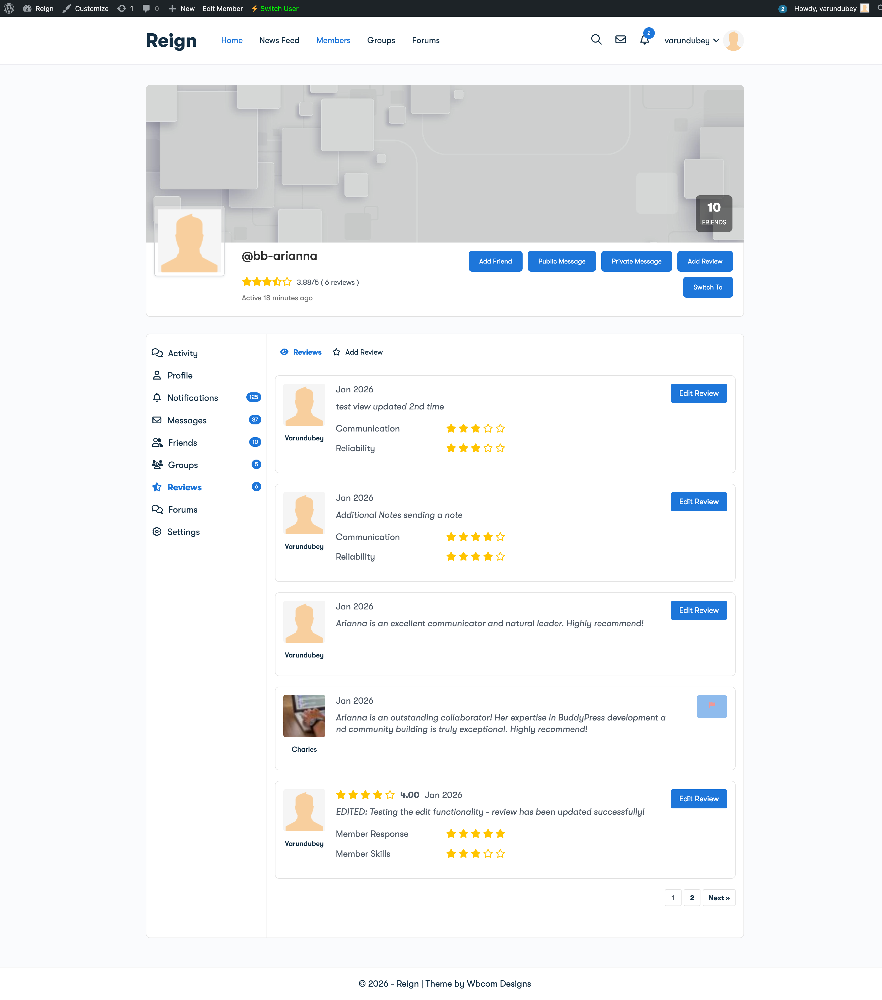
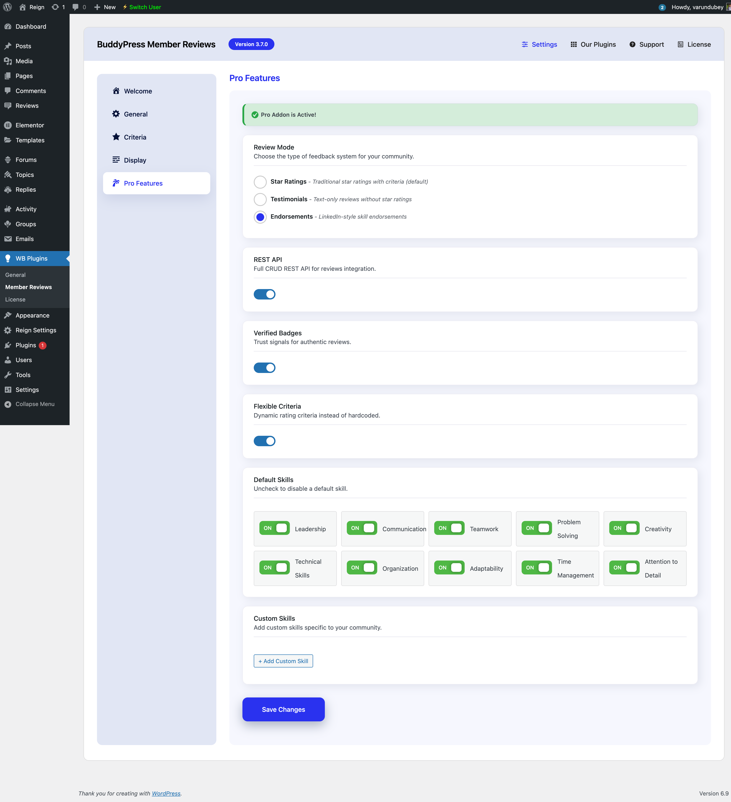

# BuddyPress Member Reviews - Documentation

Welcome to the official documentation for BuddyPress Member Reviews, a comprehensive review and rating system for BuddyPress communities.

## What You Can Do

### Build Trust in Your Community
- **Star Ratings** - Members rate each other on customizable criteria
- **Written Reviews** - Text feedback for detailed testimonials
- **Verified Badges** - Mark authentic reviews with trust signals (Pro)
- **Top Members Display** - Showcase highly-rated members

### Keep It Safe
- **Review Reporting** - Let users report inappropriate content
- **Auto-Hide** - Reviews hidden after reaching report threshold
- **Moderation Queue** - Approve reviews before publishing
- **Anonymous Option** - Let reviewers stay private

### Choose Your Style (Pro)
- **Ratings Mode** - Traditional star ratings with criteria
- **Testimonials Mode** - Text-only feedback without stars
- **Endorsements Mode** - LinkedIn-style skill endorsements

---

## Download Links

### Free Version
- **Wbcom Designs:** [https://wbcomdesigns.com/downloads/buddypress-member-reviews/](https://wbcomdesigns.com/downloads/buddypress-member-reviews/)
- **WordPress.org:** [https://wordpress.org/plugins/bp-user-profile-reviews/](https://wordpress.org/plugins/bp-user-profile-reviews/)

### Pro Version
- **Product Page:** [https://wbcomdesigns.com/downloads/buddypress-member-reviews-pro](https://wbcomdesigns.com/downloads/buddypress-member-reviews-pro)
- **Item Name:** BuddyPress Member Reviews Pro
- **Item ID:** post=1649751

---

## Documentation Index

### For Site Administrators

| Guide | Description |
|-------|-------------|
| [Getting Started](website/getting-started/installation.md) | Installation, requirements, and initial setup |
| [Admin Settings](website/usage/settings-reference.md) | Complete settings reference |
| [Managing Reviews](website/usage/managing-reviews.md) | Approve, edit, and moderate reviews |
| [Shortcodes](website/shortcodes/shortcodes.md) | Display top members anywhere |
| [Widgets](website/shortcodes/widgets.md) | Sidebar widgets for reviews |

### For Developers

| Guide | Description |
|-------|-------------|
| [Hooks Reference](website/developer-guide/hooks-and-filters.md) | Actions and filters for customization |
| [Template Overrides](website/developer-guide/templates.md) | Customize review display |
| [Database Schema](website/developer-guide/data-model.md) | Post meta and user meta reference |

### Pro Feature Guides

Testimonials, Endorsements, Verified badges, the criteria builder and the REST API are part of the Member Reviews Pro add-on. Their guides ship with the Pro add-on in its own `docs/website/` folder.

### Reference Files

| File | Description |
|------|-------------|
| [FILE_INDEX.md](FILE_INDEX.md) | Complete file listing with purposes |
| [PLUGIN_ARCHITECTURE.md](architecture/PLUGIN_ARCHITECTURE.md) | Technical architecture reference |
| [FAQ](website/faq/faqs.md) | Frequently asked questions |

---

## Video Guides

Watch these short video tutorials to get started quickly.

### Getting Started
| Video | Duration | Description |
|-------|----------|-------------|
| [Installation Guide](https://wbcomdesigns.com/videos/bp-member-reviews/installation-guide) | 40s | Configure settings, permissions, criteria, and display |
| [Shortcodes & Widgets](https://wbcomdesigns.com/videos/bp-member-reviews/shortcodes-guide) | 30s | Display top members anywhere on your site |
| [Admin Guide](https://wbcomdesigns.com/videos/bp-member-reviews/admin-guide) | 35s | Moderate reviews, handle reports, owner replies |

### Pro Features
| Video | Duration | Description |
|-------|----------|-------------|
| [Pro Features Overview](https://wbcomdesigns.com/videos/bp-member-reviews/pro-features-guide) | 35s | Three modes, verified badges, and more |
| [Testimonials Mode](https://wbcomdesigns.com/videos/bp-member-reviews/testimonials-guide) | 35s | Text-only feedback for courses and coaching |
| [Endorsements Mode](https://wbcomdesigns.com/videos/bp-member-reviews/endorsements-guide) | 35s | LinkedIn-style skill endorsements |
| [Verified Badges](https://wbcomdesigns.com/videos/bp-member-reviews/verified-badges-guide) | 30s | Trust signals that increase conversions |

### Short Ads
| Video | Duration | Description |
|-------|----------|-------------|
| [Trust Problem Ad](https://wbcomdesigns.com/videos/bp-member-reviews/trust-ad) | 15s | "Who can you trust?" - Community reviews |
| [Three Modes Ad](https://wbcomdesigns.com/videos/bp-member-reviews/three-modes-ad) | 15s | Ratings, Testimonials, Endorsements |

---

## Feature Comparison

### Free Features

| Feature | Description |
|---------|-------------|
| Star Ratings | 1-5 star ratings with visual display |
| Multiple Criteria | Configure custom rating criteria (Quality, Communication, etc.) |
| Owner Replies | Profile owners can respond to reviews |
| Review Reporting | Users can report inappropriate reviews |
| Auto-Hide Threshold | Reviews auto-hidden after X reports |
| Email Notifications | Notify members of new reviews |
| BuddyPress Notifications | In-app notification bell alerts |
| Anonymous Reviews | Option for reviewers to stay anonymous |
| Activity Stream | Post reviews to BuddyPress activity feed |
| Profile Header Ratings | Display aggregate rating on member profiles |
| Top Members Shortcode | `[bupr_display_top_members]` shortcode |
| Review Widget | Sidebar widget for recent reviews |
| Member Rating Widget | Display member's rating on profile |
| Template Overrides | Customize templates via theme |
| Role-Based Access | Control who can review and be reviewed |
| Review Editing | Allow members to edit their reviews |
| Moderation Queue | Approve reviews before publishing |

### Pro Features

| Feature | Description |
|---------|-------------|
| **Review Modes** | |
| Testimonials Mode | Text-only reviews without star ratings |
| Endorsements Mode | LinkedIn-style skill endorsement system |
| **Trust & Verification** | |
| Verified Badges | Mark authentic reviews with trust signals |
| Auto-Verify by Tenure | Auto-verify reviews from long-term members |
| Admin Verification | Manual verification from admin panel |
| **Advanced Criteria** | |
| Flexible Criteria Builder | Create criteria with stars, thumbs, or text |
| Weighted Ratings | Assign weights to criteria for averages |
| **API & Integration** | |
| REST API | Full CRUD API for mobile apps and integrations |
| Webhooks Support | Trigger external services on review events |
| **Endorsement Features** | |
| Skill Selection Modal | Choose skills to endorse |
| Custom Skills | Admin-defined skill list |
| Pending Requests | Approve/decline endorsement requests |

---

## Quick Start

### Installation

1. Download from [WordPress.org](https://wordpress.org/plugins/bp-user-profile-reviews/)
2. Upload to `/wp-content/plugins/`
3. Activate in WordPress admin
4. Go to **Settings > Member Reviews** to configure

### Basic Configuration

1. **General Tab**: Set auto-approve, notifications, flagging options
2. **Criteria Tab**: Define rating criteria (Quality, Communication, etc.)
3. **Display Tab**: Customize star colors, labels, positions
4. **Shortcode Tab**: Generate shortcodes for your pages

### Pro Addon

1. Purchase from [Wbcom Designs](https://wbcomdesigns.com/downloads/buddypress-member-reviews-pro)
2. Install alongside the free plugin
3. Activate and enter license key
4. Configure review mode in **Settings > Member Reviews > Pro**

---

## Requirements

| Requirement | Minimum | Recommended |
|-------------|---------|-------------|
| WordPress | 5.0 | 6.0+ |
| PHP | 7.4 | 8.0+ |
| BuddyPress/BuddyBoss | 6.0 | Latest |
| MySQL | 5.6 | 8.0 |

---

## Support

### Free Plugin Support
- [WordPress.org Support Forum](https://wordpress.org/support/plugin/bp-user-profile-reviews/)
- [Online Documentation](https://docs.wbcomdesigns.com/docs/buddypress-member-review/)

### Pro Plugin Support
- Priority email support at support@wbcomdesigns.com
- [Online Docs](https://docs.wbcomdesigns.com/docs/buddypress-member-review/)

---

## Version Information

| Version | Plugin |
|---------|--------|
| Free | 3.7.0 |
| Pro | 1.0.0 |

**Last Documentation Update:** 2026-01-26
