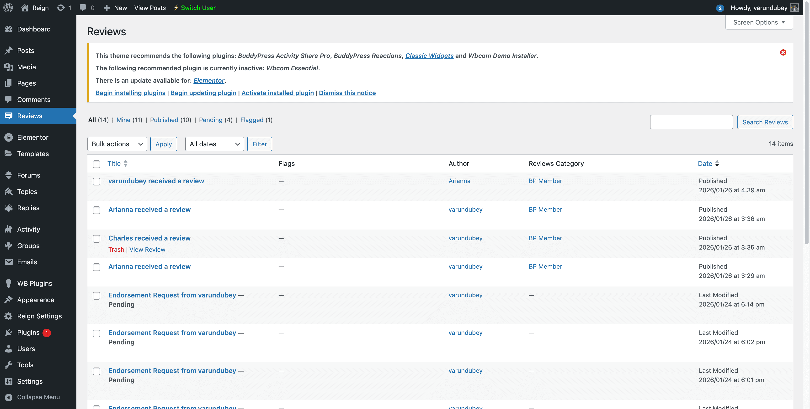

# Managing Reviews

How to moderate, approve, and manage member reviews from the WordPress admin.

> **Video Guide:** Watch the [Admin Guide (35s)](https://wbcomdesigns.com/videos/bp-member-reviews/admin-guide) to see moderation, reports, and owner replies in action.

## Accessing Reviews

Go to **Reviews** in the WordPress admin sidebar to see all reviews.

### Review List Columns

| Column | Description |
|--------|-------------|
| Title | Review subject/title (click to edit) |
| Rating | Star rating given |
| Author | Who wrote the review |
| Member | Who received the review |
| Reports | Number of times reported (if any) |
| Date | When submitted |

### Filtering Reviews

Use the dropdown filters to show:

- **All** - Every review
- **Published** - Live reviews
- **Pending** - Awaiting approval
- **Draft** - Saved but not submitted
- **Reported** - Reviews reported by users

## Approving Reviews

When **Auto Approve Reviews** is disabled, new reviews go to Pending status.

### Approve a Single Review

1. Go to **Reviews > All Reviews**
2. Hover over a Pending review
3. Click **Approve**

### Bulk Approve

1. Check multiple reviews
2. Select **Publish** from the Bulk Actions dropdown
3. Click **Apply**

## Editing Reviews

### When to Edit

- Remove inappropriate language while keeping the review
- Fix obvious typos
- Correct formatting issues

### How to Edit

1. Click the review title
2. Modify content in the editor
3. Click **Update**

**Note:** Editing a review does not notify the reviewer or the member being reviewed.

## Handling Reported Reviews

When members report a review, you'll see a report count in the admin list.

### Report Indicators

| Status | Meaning |
|--------|---------|
| No indicator | Not reported |
| Warning icon + count | Has active reports |
| Auto-hidden badge | Exceeded report threshold |

### Reviewing Reports

1. Click on a reported review to edit
2. Scroll to the **Report Details** meta box
3. Review each report's reason and reporter

### Report Reasons

Users can report reviews for:

- Spam or fake review
- Harassment or abuse
- Inappropriate content
- Conflict of interest

### Taking Action

After reviewing reports:

| Action | How | Effect |
|--------|-----|--------|
| Dismiss reports | Click "Dismiss Reports" | Clears report count, review stays live |
| Keep hidden | Leave as-is | Review remains hidden from public |
| Delete review | Move to Trash | Permanently removes review |
| Edit content | Modify and update | Fix issues, then dismiss reports |

## Owner Replies

Profile owners can reply once to each review they receive.

### Viewing Replies

In the review edit screen, scroll to **Owner Reply** section to see:

- Reply content
- Reply date
- Reply author

### Managing Replies

You can:

- **Edit** the reply content
- **Delete** the reply by clearing the field
- Replies cannot be added by admins (only profile owners)

## Bulk Actions

Available bulk actions:

| Action | Effect |
|--------|--------|
| Edit | Opens Quick Edit for multiple reviews |
| Move to Trash | Deletes selected reviews |
| Publish | Approves pending reviews |

## Review Data

Each review stores:

| Data | Location |
|------|----------|
| Content | Post content |
| Rating | `profile_star_rating` post meta (array) |
| Member reviewed | `linked_bp_member` post meta (user ID) |
| Anonymous status | `bupr_anonymous_review_post` post meta |
| Owner reply | `bupr_owner_reply` post meta |
| Reports | `bupr_flags` post meta (array) |

## Aggregate Ratings

Member ratings update automatically when:

- A review is published
- A review is unpublished/trashed
- A review's rating is edited

The aggregate is stored in user meta:

- `bupr_review_count` - Total published reviews
- `bupr_aggregate_rating` - Average rating (1-5)

### Manual Recalculation

If ratings seem incorrect:

1. Edit any review for the affected member
2. Click **Update**
3. This triggers a recalculation

## Best Practices

### Moderation Guidelines

1. **Respond promptly** - Check pending reviews daily
2. **Be consistent** - Apply the same standards to all reviews
3. **Preserve authentic feedback** - Only edit for policy violations
4. **Document decisions** - Use the Notes field for internal tracking

### Preventing Spam

1. Keep **Auto Approve Reviews** disabled initially
2. Set a reasonable **Auto-Hide Threshold** (3-5)
3. Restrict **Reviewer Roles** to verified members
4. Disable **Anonymous Reviews** if abuse occurs

### Handling Disputes

When a member disputes a review:

1. Review the reports
2. Check if review violates community guidelines
3. Consider if content is factual vs. opinion
4. Either dismiss the reports or remove the review
5. Optionally notify both parties of your decision
