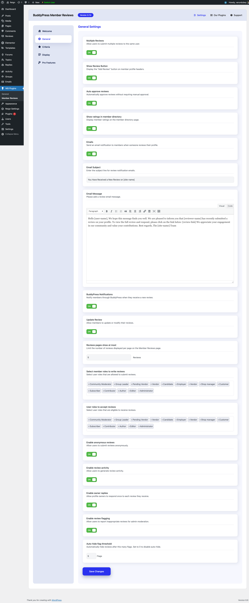
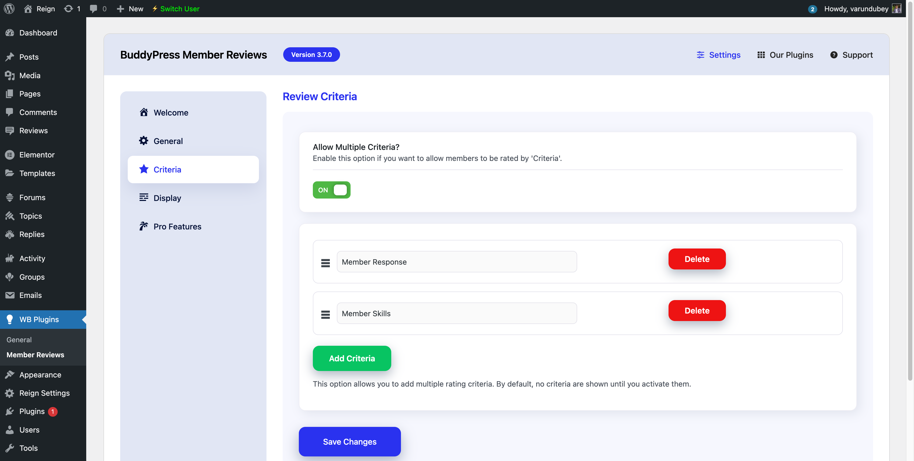
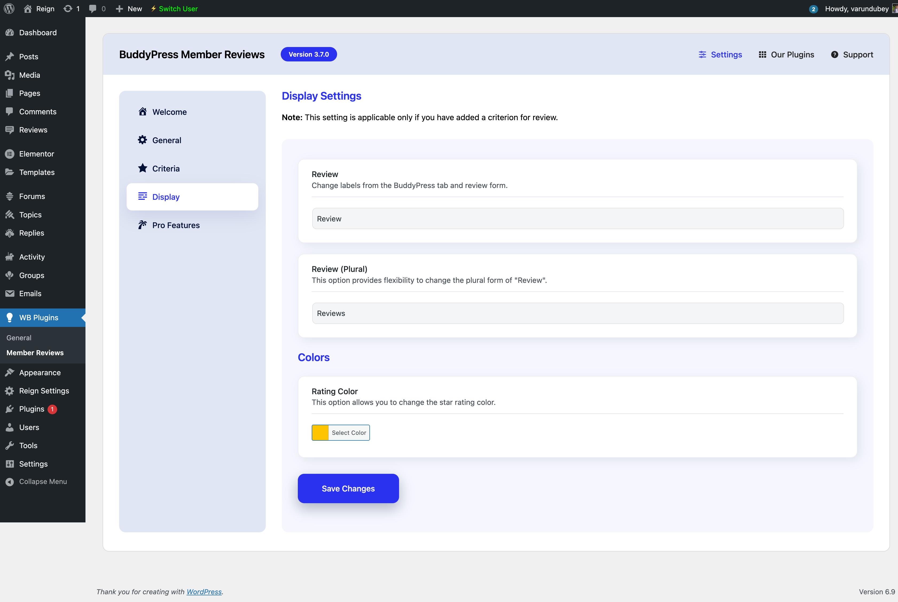
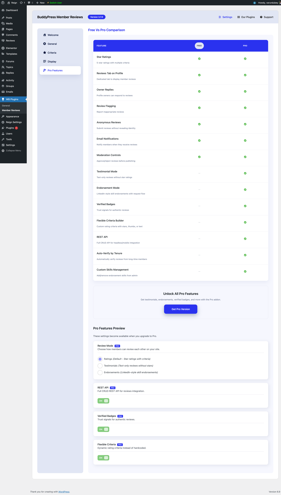

# Admin Settings Reference

Complete reference for all BuddyPress Member Reviews settings, located at **Settings > Member Reviews**.

## General Tab

### Review Submission

| Setting | Description | Default |
|---------|-------------|---------|
| Multiple Reviews | Allow users to submit multiple reviews to the same member | Off |
| Show Review Button | Display "Add Review" button on member profile headers | On |
| Auto Approve Reviews | Publish reviews immediately without admin approval | Off |
| Update Review | Allow members to edit their submitted reviews | Off |

**Recommendation:** Keep auto-approve off for new communities to prevent spam. Once your community is established, you can enable it.

### Display Options

| Setting | Description | Default |
|---------|-------------|---------|
| Member Directory Ratings | Display star ratings on the members list page | On |
| Reviews Per Page | Number of reviews per page on profile | 10 |

### Role Permissions

| Setting | Description |
|---------|-------------|
| Reviewer Roles | User roles allowed to submit reviews |
| Reviewee Roles | User roles that can receive reviews on their profile |

**Example:** For a freelancer marketplace, allow "Subscriber" to write reviews and "Freelancer" (custom role) to receive them.

### Notifications

| Setting | Description | Default |
|---------|-------------|---------|
| Email Notifications | Send email when member receives a review | On |
| BuddyPress Notifications | Show notification in BuddyPress notification area | On |

### Email Templates

Customize email content with these placeholders:

| Placeholder | Description |
|------------|-------------|
| `[user-name]` | Recipient's display name |
| `[reviewer-name]` | Reviewer's display name |
| `[review-link]` | Link to view the review |
| `[site-name]` | Your site name |
| `[site-admin]` | Admin username (for approval emails) |
| `[review-aproval-link]` | Link to approve the review |

### Privacy & Moderation

| Setting | Description | Default |
|---------|-------------|---------|
| Anonymous Reviews | Let reviewers hide their identity | Off |
| Activity Stream | Post reviews to BuddyPress activity stream | On |
| Owner Replies | Let profile owners respond to reviews | On |
| Review Reporting | Let members report inappropriate reviews | On |
| Auto-Hide Threshold | Automatically hide after X reports (0 = disabled) | 5 |

## Criteria Tab

### Multiple Criteria

Enable **Multiple Criteria** to rate members on specific aspects instead of a single overall rating.

### Adding Criteria

1. Click **Add Criteria**
2. Enter a label (e.g., "Communication Skills")
3. Click **Save Changes**

### Managing Criteria

- **Reorder:** Drag criteria using the handle (≡)
- **Delete:** Click the Delete button
- **Rename:** Edit the text field directly

**Tip:** Use 3-5 criteria for best user experience. Too many criteria can overwhelm reviewers.

### Example Criteria Sets

**Service Provider:**
- Quality of Work
- Communication
- Timeliness
- Value for Money
- Would Recommend

**Professional Network:**
- Expertise
- Collaboration
- Responsiveness

**Tutor/Instructor:**
- Knowledge
- Teaching Style
- Patience
- Preparation

## Display Tab

### Labels

| Setting | Description | Default |
|---------|-------------|---------|
| Review Label | Singular form used throughout the plugin | Review |
| Reviews Label (Plural) | Plural form | Reviews |

**Use case:** Change to "Testimonial/Testimonials" or "Feedback" to match your community's terminology.

### Colors

| Setting | Description | Default |
|---------|-------------|---------|
| Rating Color | Star rating color | Gold (#ffb900) |

## Shortcode Tab

Reference for the `[bupr_display_top_members]` shortcode. See [Shortcodes Guide](shortcodes.md) for full details.

## Pro Features Tab

Preview of features available in BuddyPress Member Reviews Pro:

| Feature | Description |
|---------|-------------|
| Review Modes | Switch between Ratings, Testimonials, or Endorsements |
| Verified Badges | Mark trusted reviews with a verification badge |
| REST API | Full API access for headless/mobile apps |
| Flexible Criteria | Add thumbs up/down and text fields beyond stars |
| Endorsement Mode | LinkedIn-style skill endorsements |

## Support Tab

Links to documentation, support forums, and Wbcom Designs contact information.
