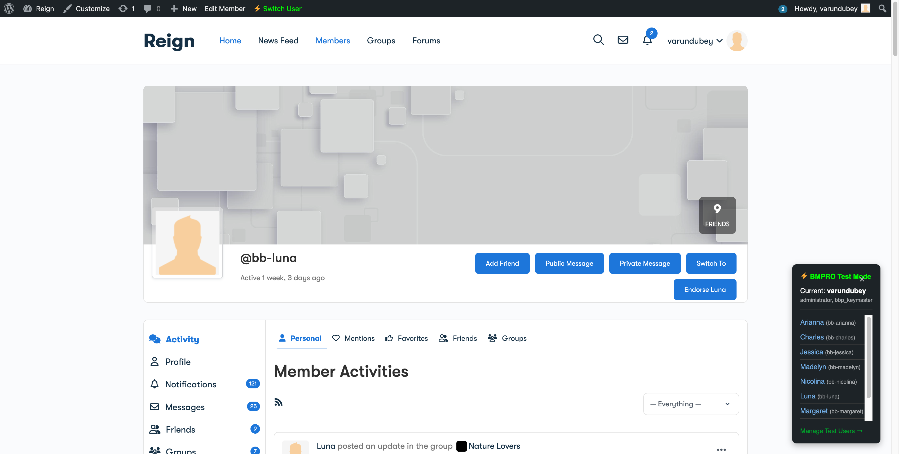
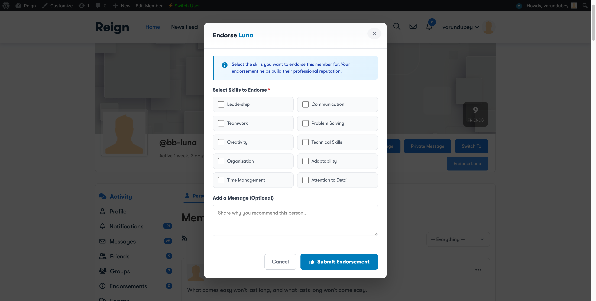
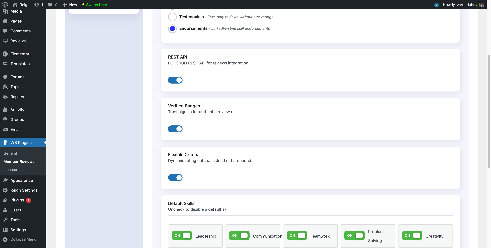

# Endorsements Mode

Add LinkedIn's missing feature to BuddyPress. Let members endorse each other's skills and build professional credibility.



## The Problem Endorsements Solve

**Star ratings don't fit professional networks.** Rating a colleague 4.5 stars feels weird. You don't give your coworker a "quality score" — you vouch for their skills.

**Generic reviews lack context.** "Great to work with" is nice but meaningless. What specifically are they good at? What can they help with?

**LinkedIn solved this, but you're not on LinkedIn.** Your BuddyPress community needs the same trust-building mechanism — skill endorsements that show what members are actually known for.

---

## What Endorsements Look Like

### Profile Header
Instead of "Add Review" → **"Endorse Sarah"**

### Profile Tab
Instead of star ratings → **Skill tags with endorsement counts**

```
[Leadership (12)] [Communication (8)] [WordPress (5)] [Project Management (4)]
```

### Endorsement Display
Instead of review text → **Skills endorsed with optional message**

> Endorsed **Leadership, Communication, Project Management**
>
> "Sarah led our entire product launch. Calm under pressure, clear communicator."
> — **Mike Rodriguez**

---

## Why Members Love Endorsements

### For the Person Being Endorsed
- **Credibility without asking** — Colleagues vouch for you
- **Skill portfolio** — Show what you're known for
- **Professional proof** — Better than self-proclaimed expertise

### For the Person Endorsing
- **One-click recognition** — Easier than writing a review
- **Specific and meaningful** — Endorse skills, not vague quality
- **Relationship building** — Creates mutual appreciation

### For the Community
- **Searchable expertise** — Find members by skill
- **Engagement driver** — Members return to give/get endorsements
- **Professional culture** — Signals this is a serious network

---

## Enabling Endorsements Mode

### Requirements
- BuddyPress Member Reviews (free) installed
- BuddyPress Member Reviews Pro activated

### Setup Steps

1. Go to **Settings > Member Reviews > Pro**
2. Find **Review Mode**
3. Select **Endorsements**
4. Configure skills (see below)
5. Save changes

The plugin now operates in endorsement mode:
- "Add Review" → "Endorse [Name]"
- Star ratings → Skill checkboxes
- Reviews tab → Endorsements tab
- All labels change to endorsement terminology

---

## The Endorsement Flow

### Giving an Endorsement



1. **Visit a profile** — See "Endorse [Name]" button in header
2. **Click button** — Opens skill selection modal
3. **Select skills** — Check skills you want to endorse (checkboxes)
4. **Add message (optional)** — Write a note explaining your endorsement
5. **Submit** — Click "Submit Endorsement"
6. **Confirmation** — Success! Endorsement visible in their Endorsements tab

### The Skills Modal

The modal displays:
- Member's name at the top
- Grid of available skills (alphabetically sorted)
- Optional message textarea
- Cancel and Submit buttons

**Modal behavior:**
- Lightbox overlay (darkened background)
- Centered on screen
- Click outside to close
- Escape key to close

### Requesting an Endorsement

Members can request endorsements on their OWN profile:

1. **Go to your profile** — See "Request Endorsement" button
2. **Click button** — Opens request modal
3. **Select skills** — Choose skills you want endorsed
4. **Add message** — Explain why you're requesting
5. **Submit** — Request sent

---

## Use Case: Professional Network

### The Challenge
"We built a niche professional community, but members complained it 'felt empty' compared to LinkedIn. No way to show professional credibility."

### The Solution
Switch to Endorsements Mode. Members endorse colleagues:

> Endorsed **Leadership, Strategic Thinking, Team Building**
>
> "I reported to David for 2 years. Best manager I've had — genuinely invested in team growth."
> — **Jamie Lee** ✓ Verified Colleague

### The Impact
- Profile completion jumped from 30% to 85%
- Endorsements became the #1 used feature
- Members stay longer (have something to show)

### Recommended Settings

| Setting | Value | Why |
|---------|-------|-----|
| Anonymous | Off | Professional endorsements need names |
| Verified badges | On | Mark confirmed colleagues |
| Custom skills | On | Add industry-specific skills |

---

## Use Case: Expert Directory

### The Challenge
"We have a directory of consultants, but clients can't tell who's actually good at what. Profiles just list self-reported skills."

### The Solution
Let clients and colleagues endorse consultants:

> Endorsed **WordPress Development, Technical SEO, Performance Optimization**
>
> "Hired Sarah for a complex migration. Flawless execution."
> — **Client** ✓ Verified

### The Impact
- Clients search by endorsed skills (not self-reported)
- Top-endorsed consultants get more inquiries
- Skills with most endorsements rise to top of profile

### Recommended Settings

| Setting | Value | Why |
|---------|-------|-----|
| Custom skills | On | Add your industry's specific skills |
| Verified badges | On | Mark real clients |
| Activity stream | On | Show endorsements in feed |

---

## Use Case: Freelancer Platform

### The Challenge
"Star ratings work for transactions, but freelancers want to show WHAT they're good at, not just a quality score."

### The Solution
Hybrid approach — use Ratings mode for client reviews, but show endorsed skills on profiles via shortcode.

Or switch entirely to Endorsements for a skill-first platform:

> Endorsed **React Development, API Integration, Clean Code**
>
> "Built our entire dashboard. Fast, communicative, great code quality."
> — **Client**

---

## Skill Management

### Configuring Available Skills



1. Go to **Settings > Member Reviews > Pro**
2. Find **Endorsement Skills** section
3. Enable/disable default skills (checkboxes)
4. Add custom skills (one per line)
5. Save changes

### Default Skills

The plugin includes these professional skills:

- Leadership
- Communication
- Problem Solving
- Teamwork
- Creativity
- Technical Skills
- Project Management
- Time Management
- Adaptability
- Attention to Detail

### Adding Custom Skills

In the Custom Skills text area, add one skill per line:

```
WordPress Development
PHP Programming
UI/UX Design
Content Strategy
SEO Optimization
Client Management
Agile Methodology
```

### Skill Display

Skills appear as tags on profiles:

```
[Leadership (5)] [Communication (3)] [WordPress (8)]
```

- Skill name
- Endorsement count in parentheses
- Hover shows who endorsed

---

## Managing Endorsement Requests

### Pending Requests Tab

When members request endorsements, requests appear in a subnav:

**Tab visibility:**
- Only appears when pending requests exist
- Hidden when no pending requests
- Shows count: "Pending Requests (3)"

### Request Display

Each request shows:
- Requester's avatar and name
- Skills they want endorsed
- Their message (if provided)
- Request date
- Approve/Decline buttons

### Taking Action

| Action | What Happens |
|--------|--------------|
| **Approve** | Endorsement published, skills appear on their profile |
| **Decline** | Request removed, no endorsement created |

---

## Endorsements + Verified Badges

Combine endorsements with verification for maximum credibility.

### Why It Works

| Without Verification | With Verification |
|---------------------|-------------------|
| "Mike endorsed your Leadership" | "Mike ✓ Verified Colleague endorsed your Leadership" |
| Could be a random connection | Proven professional relationship |

### Setting Up Verified Endorsements

1. Enable Verified Badges in Pro settings
2. When you endorse someone, admin can verify your relationship
3. Badge appears on the endorsement

---

## Developer Integration

### Check if Endorsements Mode Active

```php
if ( class_exists( 'BUPR_Pro_Features' ) ) {
    $mode = BUPR_Pro_Features::get_review_mode();
    if ( $mode === 'endorsements' ) {
        // Endorsements mode is active
    }
}
```

### Get Member's Endorsed Skills

```php
// Get all endorsements for a member
$args = array(
    'post_type'  => 'review',
    'meta_query' => array(
        array(
            'key'   => 'linked_bp_member',
            'value' => $member_id,
        ),
        array(
            'key'   => 'bupr_endorsement_status',
            'value' => 'approved',
        ),
    ),
);
$endorsements = new WP_Query( $args );

// Aggregate skill counts
$skills = array();
foreach ( $endorsements->posts as $endorsement ) {
    $endorsed = get_post_meta( $endorsement->ID, 'bupr_endorsed_skills', true );
    foreach ( (array) $endorsed as $skill ) {
        if ( ! isset( $skills[ $skill ] ) ) {
            $skills[ $skill ] = 0;
        }
        $skills[ $skill ]++;
    }
}
// $skills = ['Leadership' => 5, 'Communication' => 3, ...]
```

### REST API

```
GET  /wp-json/bupr/v1/members/{id}/endorsements
POST /wp-json/bupr/v1/endorsements
POST /wp-json/bupr/v1/endorsements/{id}/approve
POST /wp-json/bupr/v1/endorsements/{id}/decline
```

---

## FAQ

### Can I endorse someone multiple times?

No. Each member can endorse another member once. You can edit your endorsement to add/remove skills.

### What happens to existing reviews when I switch to Endorsements?

Reviews remain in the database but display differently. Star ratings hide, text content shows as the endorsement message.

### Can members endorse themselves?

No. The "Endorse [Name]" button only appears on OTHER members' profiles.

### How do I switch back to Ratings mode?

Go to **Settings > Member Reviews > Pro** → change Review Mode to "Ratings". Endorsements remain but display as reviews.

### Are endorsements anonymous?

No. Endorsements always show who gave them. In professional contexts, anonymous endorsements would be meaningless.

### Can I use Endorsements and Ratings together?

Not currently — it's one mode or the other. But you can switch back and forth; data is preserved.
