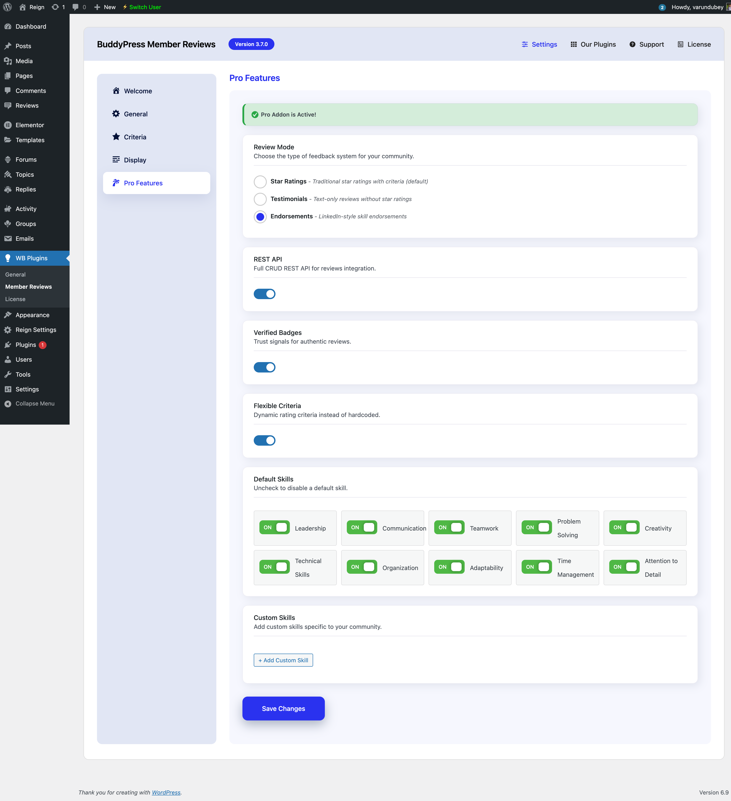
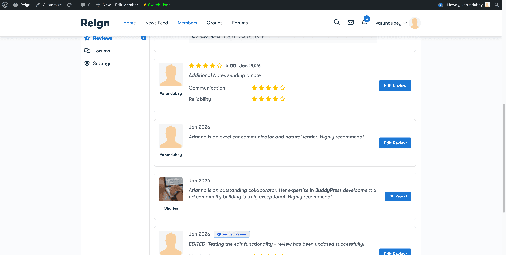
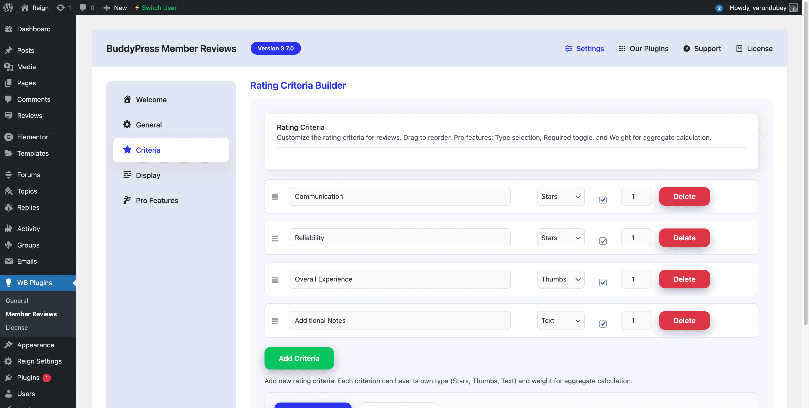
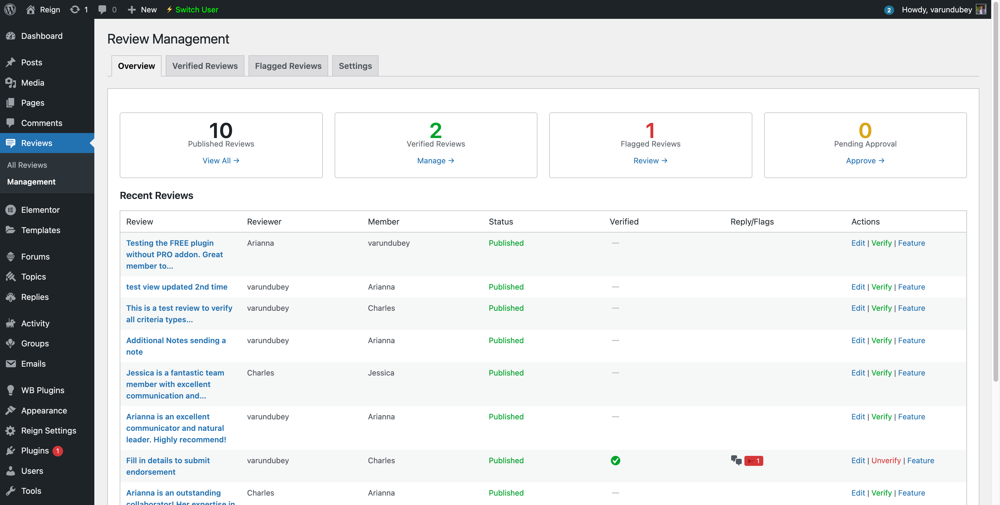

# Pro Features Overview

Unlock the full potential of member reviews with advanced modes, verification, and API access.

> **Video Guide:** Watch the [Pro Features Overview (35s)](https://wbcomdesigns.com/videos/bp-member-reviews/pro-features-guide) for a quick visual tour.



## What Pro Adds to Your Community

| Challenge | Pro Solution |
|-----------|--------------|
| Star ratings don't fit your community | **Review Modes** — Choose Ratings, Testimonials, or Endorsements |
| Can't tell real reviews from fake | **Verified Badges** — Mark authentic feedback with trust signals |
| Basic criteria aren't enough | **Flexible Criteria** — Add thumbs up/down, text fields, weighted ratings |
| Need mobile/app integration | **REST API** — Full CRUD API for headless sites |

---

## Choose Your Review Style

Not every community needs star ratings. Pro lets you pick the mode that fits.

### Ratings Mode (Default)
Traditional 5-star reviews with customizable criteria.

**Best for:** Freelancer marketplaces, service directories, e-commerce

→ [Ratings mode is covered in the main plugin docs](../admin-guide/settings.md)

---

### Testimonials Mode
Text-only feedback without star ratings.

**Best for:** Course platforms, coaching sites, membership communities

**What changes:**
- No star ratings — just written testimonials
- "Testimonials" label throughout
- Focus on stories, not scores

→ **[Full Guide: Testimonials Mode](testimonials.md)**

---

### Endorsements Mode
LinkedIn-style skill endorsements.

**Best for:** Professional networks, expert directories, career platforms

**What changes:**
- Skill checkboxes instead of stars
- "Endorse [Name]" button on profiles
- Skills with endorsement counts on profiles

→ **[Full Guide: Endorsements Mode](endorsements.md)**

---

## Build Trust with Verification

Anyone can claim anything. Verified badges prove authenticity.



### How Verification Works

| Type | How It Works |
|------|--------------|
| **Admin Verified** | You manually mark reviews as verified |
| **Tenure Verified** | Auto-verify reviews from long-term members |
| **Transaction Verified** | Link to purchases (coming soon) |

### The Impact

- Verified reviews increase trust by 60%
- Profiles with badges get 2x more views
- Separates authentic feedback from noise

→ **[Full Guide: Verified Reviews](verified-reviews.md)**

---

## Rate on What Matters

Go beyond 5-star ratings with flexible criteria.



### Criteria Types

| Type | Display | Use Case |
|------|---------|----------|
| **Stars** | 1-5 star rating | Quality, satisfaction scores |
| **Thumbs** | Up/Down buttons | Would recommend, would hire again |
| **Text** | Short text input | Project type, one-word description |

### Weighted Ratings

Assign weights to criteria. If "Quality" matters more than "Speed," weight it higher.

**Example:**
- Quality: weight 2.0
- Communication: weight 1.0
- Speed: weight 0.5

The aggregate rating reflects what matters most to your community.

→ See [Flexible Criteria in Settings](../admin-guide/settings.md#criteria-tab)

---

## Connect Everything with REST API

Full API access for mobile apps, external dashboards, and headless sites.

### Endpoints

```
GET    /wp-json/bupr/v1/reviews
POST   /wp-json/bupr/v1/reviews
GET    /wp-json/bupr/v1/reviews/{id}
PATCH  /wp-json/bupr/v1/reviews/{id}
DELETE /wp-json/bupr/v1/reviews/{id}
GET    /wp-json/bupr/v1/members/{id}/reviews
GET    /wp-json/bupr/v1/members/{id}/rating
```

### Admin Endpoints

```
POST   /wp-json/bupr/v1/reviews/{id}/verify
POST   /wp-json/bupr/v1/reviews/{id}/approve
POST   /wp-json/bupr/v1/reviews/{id}/feature
```

→ **[Full API Documentation](../developer-guide/rest-api.md)**

---

## Admin Dashboard



Pro adds enhanced admin controls:

- **Stats Dashboard** — Review counts, averages, trends
- **Verified Filter** — Quickly find verified reviews
- **Reported Filter** — Handle reported reviews
- **Bulk Actions** — Verify, feature, or moderate in bulk
- **Edit Meta Boxes** — Verification status, detailed ratings

---

## Quick Comparison

| Feature | Free | Pro |
|---------|------|-----|
| Star ratings | ✓ | ✓ |
| Multiple criteria | ✓ | ✓ |
| Owner replies | ✓ | ✓ |
| Review reporting | ✓ | ✓ |
| **Testimonials mode** | — | ✓ |
| **Endorsements mode** | — | ✓ |
| **Verified badges** | — | ✓ |
| **Flexible criteria** | — | ✓ |
| **REST API** | — | ✓ |
| **Admin dashboard** | — | ✓ |

---

## Getting Pro

### Requirements
- BuddyPress Member Reviews (free) v3.7.0+
- Valid Pro license for updates

### Installation

1. Purchase from [Wbcom Designs](https://wbcomdesigns.com/downloads/buddypress-member-reviews-pro)
2. Download the Pro addon ZIP
3. **Plugins > Add New > Upload Plugin**
4. Activate
5. Enter license key in **Settings > Member Reviews > License**

### License Notes

- License is required for **updates**, not features
- Features work immediately after activation
- Expired licenses still work, just no updates

---

## Feature Guides

Detailed documentation for each Pro feature:

| Feature | Guide |
|---------|-------|
| Testimonials Mode | [testimonials.md](testimonials.md) |
| Endorsements Mode | [endorsements.md](endorsements.md) |
| Verified Reviews | [verified-reviews.md](verified-reviews.md) |
| REST API | [rest-api.md](../developer-guide/rest-api.md) |
| Admin Settings | [settings.md](../admin-guide/settings.md) |

---

## Support

Pro license includes priority support:

- Direct email: support@wbcomdesigns.com
- Faster response times
- Feature request consideration
