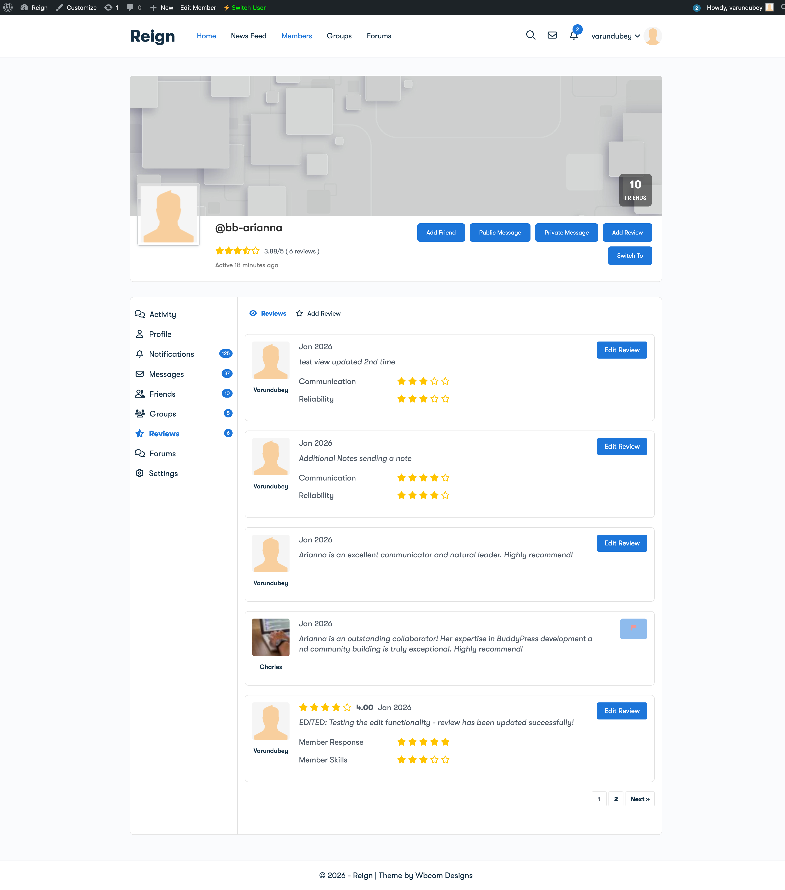

# Testimonials Mode

Skip star ratings when words say more. Perfect for courses, membership sites, and communities focused on qualitative feedback.

> **Video Guide:** Watch the [Testimonials Mode Guide (35s)](https://wbcomdesigns.com/videos/bp-member-reviews/testimonials-guide) for a quick visual walkthrough.



## The Problem Testimonials Mode Solves

**Star ratings feel transactional.** When a student rates an instructor 4.5 stars, what does that actually mean? When a member gives a coach 5 stars, prospective clients still ask: "But what did they help with?"

**Words tell stories.** A testimonial like "Sarah helped me land my first developer job after 3 months of coaching" converts 10x better than a 5-star rating.

**Your community isn't Yelp.** Professional communities, course platforms, and coaching sites need rich testimonials — not restaurant-style star ratings.

---

## What Changes in Testimonials Mode

| With Ratings Mode | With Testimonials Mode |
|-------------------|------------------------|
| Star ratings required | Text feedback only |
| Aggregate "4.7 stars" on profiles | No numeric ratings displayed |
| "Reviews" label | "Testimonials" label |
| Focus: How good? | Focus: What happened? |

**Best for:**
- Course platforms (student feedback on instructors)
- Coaching/consulting (client success stories)
- Membership communities (member experiences)
- Professional services (client recommendations)

---

## Enabling Testimonials Mode

### Requirements
- BuddyPress Member Reviews (free) installed
- BuddyPress Member Reviews Pro activated

### Setup Steps

1. Go to **Settings > Member Reviews > Pro**
2. Find **Review Mode**
3. Select **Testimonials**
4. Save changes

That's it. The entire plugin now operates in testimonial mode:
- "Add Review" becomes "Add Testimonial"
- Star rating fields are hidden
- Aggregate ratings disappear from profiles
- All labels change to "Testimonial" terminology

---

## The Testimonial Flow

### For Members Writing Testimonials

1. **Visit a profile** — Navigate to the member you want to endorse
2. **Click "Add Testimonial"** — Button appears in Reviews tab
3. **Write your experience** — Focus on what happened, what you learned, or results achieved
4. **Submit** — Testimonial goes to moderation queue (or publishes immediately if auto-approve is on)

### For Members Receiving Testimonials

1. **Get notified** — Email + BuddyPress notification when testimonial arrives
2. **View on your profile** — Testimonials tab displays all feedback
3. **Reply (optional)** — Thank the writer with an owner reply

### For Administrators

1. **Approve testimonials** — Review queue in WordPress admin
2. **Edit if needed** — Clean up typos or formatting
3. **Feature the best** — Verify standout testimonials (Pro)

---

## Use Case: Course Platform

### The Challenge
"We have amazing instructors, but new students don't know who to pick. Star ratings feel too simple — a 4.8 doesn't tell you what you'll learn."

### The Solution
Switch to Testimonials Mode. Students write about their experience:

> "Before taking David's WordPress course, I couldn't build a simple plugin. 6 weeks later, I had my first client project. His teaching style made complex concepts click."
> — **Sarah Chen**, Junior Developer

### The Impact
- Course pages with 5+ testimonials convert 2x better
- Instructors request testimonials (they want social proof)
- Students make informed decisions based on real experiences

### Recommended Settings

| Setting | Value | Why |
|---------|-------|-----|
| Auto-approve | On | Students are verified at enrollment |
| Owner replies | On | Let instructors thank students |
| Review reporting | On | Community flags inappropriate content |
| Activity stream | On | New testimonials appear in activity feed |

---

## Use Case: Coaching/Consulting Site

### The Challenge
"Star ratings don't capture what coaching delivers. A client might rate me 5 stars, but that doesn't tell prospects what I helped them achieve."

### The Solution
Testimonials Mode + Verified Badges. Clients write about outcomes:

> "When I started with Mike, I was stuck at $50K/year freelancing. He helped me reposition as a consultant. I hit $150K within 8 months. The investment paid for itself 10x over."
> — **Jamie Lee**, Verified Client ✓

### The Impact
- Prospects see specific results, not vague ratings
- Verified badges add credibility to claims
- Coaches can request testimonials from successful clients

### Recommended Settings

| Setting | Value | Why |
|---------|-------|-----|
| Auto-approve | Off | Review before publishing (sensitive content) |
| Anonymous | Off | Real names add credibility |
| Verified badges | On | Mark clients you've worked with |

---

## Use Case: Membership Community

### The Challenge
"Our community is about connection, not transactions. Star ratings feel weird for a place people come to learn and grow together."

### The Solution
Testimonials Mode creates a supportive feedback culture:

> "I was nervous joining a fitness community online. Everyone here has been so encouraging. Lost 40 lbs with help from members who've been through the same journey."
> — **Michelle Torres**, Member since 2024

### The Impact
- New members see positive experiences
- Creates culture of appreciation
- Testimonials replace awkward rating systems

---

## Testimonials on Your Homepage

### Using the Shortcode

Display top testimonials anywhere on your site:

```
[bupr_display_top_members count="3"]
```

In Testimonials Mode, this shows members with the most testimonials (not highest ratings).

### Embedding Manually

Create a "Success Stories" page and embed testimonials using a template override. See [Templates Guide](../developer-guide/templates.md).

---

## Converting from Ratings Mode

### What Happens to Existing Reviews?

When you switch to Testimonials Mode:
- Existing reviews remain in the database
- Star ratings stop displaying (but aren't deleted)
- Review text becomes the testimonial
- You can switch back anytime — ratings reappear

### Migration Tips

1. **Export existing reviews** — Use WP All Export to backup current state
2. **Switch mode** — Enable Testimonials in Pro settings
3. **Test display** — Visit profiles to confirm testimonials look right
4. **Notify members** — Let community know about the change

---

## Requesting Testimonials

Want more testimonials? Here's what works:

### 1. Direct Outreach
After completing a project, coaching session, or course, send a personal message:

> "Hi [Name], I hope [course/project] helped you achieve [specific goal]. Would you mind sharing a quick testimonial about your experience? It helps other members find the right fit."

### 2. Automated Email Sequences
Use your email tool to send testimonial requests:
- 7 days after course completion
- After milestone achievements
- On membership anniversaries

### 3. In-Person Requests
At the end of sessions or events:

> "If this was valuable, I'd appreciate a testimonial. It helps others find us."

---

## Verified Testimonials

Combine Testimonials Mode with Verified Badges for maximum credibility.

| Without Verification | With Verification |
|---------------------|-------------------|
| Generic feedback | Verified Client ✓ |
| Anyone could write this | Proven relationship |
| Basic trust | Premium trust signal |

### How to Verify Testimonials

1. Go to **Reviews** in WordPress admin
2. Find the testimonial to verify
3. Click to edit
4. Check **Mark as Verified**
5. Save

Verified testimonials display with a checkmark badge:

```
"Best decision I made for my career."
— **Sarah Chen** ✓ Verified Testimonial
```

---

## Developer Integration

### Check if Testimonials Mode is Active

```php
if ( class_exists( 'BUPR_Pro_Features' ) ) {
    $mode = BUPR_Pro_Features::get_review_mode();
    if ( $mode === 'testimonials' ) {
        // Testimonials mode is active
    }
}
```

### Query Testimonials

```php
$args = array(
    'post_type'   => 'review',
    'post_status' => 'publish',
    'meta_query'  => array(
        array(
            'key'   => 'linked_bp_member',
            'value' => $member_id,
        ),
    ),
);
$testimonials = new WP_Query( $args );
```

### REST API

```
GET /wp-json/bupr/v1/members/{id}/reviews
```

Response in Testimonials Mode excludes `ratings` field:

```json
{
    "id": 123,
    "member_id": 45,
    "author_id": 67,
    "content": "Transformative experience...",
    "date": "2026-01-26T10:30:00",
    "verified": true
}
```

---

## FAQ

### Can I use star ratings AND testimonials together?

Not currently. It's one mode or the other. However, you can switch back and forth — data is preserved.

### What if I switch back to Ratings mode?

Star ratings reappear. Your testimonial text becomes the review text. Nothing is lost.

### Do testimonials affect member rankings?

In Testimonials Mode, the Top Members shortcode ranks by testimonial count, not average rating.

### Can testimonials be anonymous?

Yes. If "Anonymous Reviews" is enabled, writers can choose to hide their identity. The testimonial displays as "Anonymous Member."
