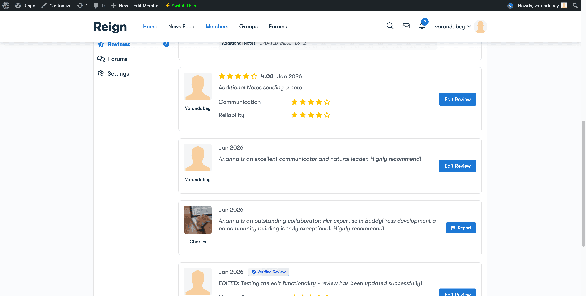

# Verified Reviews

Show which reviews come from real customers. Build trust with verification badges that separate authentic feedback from noise.

> **Video Guide:** Watch the [Verified Badges Guide (30s)](https://wbcomdesigns.com/videos/bp-member-reviews/verified-badges-guide) for a quick visual walkthrough.



## The Problem Verified Badges Solve

**Anyone can claim anything.** Without verification, a glowing 5-star review and a fake testimonial look identical. Prospective customers can't tell the difference.

**Skepticism kills conversions.** When buyers see reviews with no proof of authenticity, they discount ALL reviews — even the genuine ones.

**Trust signals work.** Studies show verified reviews increase conversion by 60% compared to unverified reviews. People trust what they can verify.

---

## What Verified Badges Add

| Without Verification | With Verification |
|---------------------|-------------------|
| "Great service!" | "Great service!" ✓ Verified Review |
| Could be anyone | Confirmed by admin |
| Generic trust | Premium credibility |

**Best for:**
- Service marketplaces (verified clients)
- Professional networks (verified colleagues)
- Course platforms (verified students)
- Any community where proof matters

---

## How Verification Works

### Verification Types

| Type | How It Works | Best For |
|------|--------------|----------|
| **Admin Verified** | Admin manually marks a review | Curated testimonials, VIP members |
| **Tenure Verified** | Auto-verify reviews from long-term members | Established communities |
| **Transaction Verified** | Link to purchases (future feature) | E-commerce, marketplaces |

### The Badge Display

Verified badges appear inline after the review date:

```
Posted on January 26, 2026 ✓ Verified Review
```

The badge includes:
- Green checkmark icon (✓)
- Mode-aware label text
- Hover tooltip with verification details

### Mode-Aware Labels

The badge text adapts to your active review mode:

| Review Mode | Badge Text |
|-------------|------------|
| Ratings | ✓ Verified Review |
| Testimonials | ✓ Verified Testimonial |
| Endorsements | ✓ Verified Endorsement |

---

## Enabling Verified Badges

### Requirements
- BuddyPress Member Reviews (free) installed
- BuddyPress Member Reviews Pro activated

### Setup Steps

1. Go to **Settings > Member Reviews > Pro**
2. Find **Verified Badges** section
3. Enable **Show Verified Badges**
4. (Optional) Set **Auto-verify tenure** — e.g., 6 months
5. Save changes

---

## Use Case: Freelancer Marketplace

### The Challenge
"Buyers don't know which reviews are from real clients. Some freelancers might be asking friends to write fake reviews."

### The Solution
Verify reviews from clients who completed projects:

> "Delivered the website 2 days early. Exceeded all expectations."
> — **Sarah Chen** ✓ Verified Client

### The Impact
- Verified reviews stand out from generic feedback
- Buyers trust profiles with verification badges
- Freelancers with verified reviews get hired more often

### How to Implement

1. **When a project completes**, manually verify the client's review
2. **Or use tenure verification** — long-term members auto-verified
3. **Display badge** on profile and review list

---

## Use Case: Professional Network

### The Challenge
"Members can claim they worked with anyone. We need a way to show verified professional relationships."

### The Solution
Verify endorsements from confirmed colleagues:

> "Incredible project manager. Kept our team on track through a tough launch."
> — **Mike Rodriguez** ✓ Verified Colleague

### The Impact
- Endorsements from verified colleagues carry more weight
- Reduces fake networking claims
- Builds trust in professional relationships

---

## Use Case: Course Platform

### The Challenge
"How do we show which testimonials come from students who actually completed the course vs. random visitors?"

### The Solution
Use tenure-based auto-verification:

> "This course changed my career. Went from junior to senior developer in 18 months."
> — **Jamie Lee** ✓ Verified Student (Member since 2024)

### The Impact
- Prospective students trust verified testimonials
- Instructors get credit for genuine student success
- Auto-verification reduces admin work

---

## Manual Verification

### Verifying a Single Review

1. Go to **Reviews** in WordPress admin
2. Click on a review to edit
3. Find **Verification Status** meta box
4. Check **Mark as Verified**
5. Click **Update**

### Bulk Verification

1. Go to **Reviews** in WordPress admin
2. Select multiple reviews (checkboxes)
3. Choose **Mark as Verified** from Bulk Actions
4. Click **Apply**

### Removing Verification

1. Edit the review
2. Uncheck **Mark as Verified**
3. Save

Or use bulk actions: **Remove Verification**

---

## Auto-Verification by Tenure

Let long-term members earn verification automatically.

### How It Works

1. Set minimum membership duration (e.g., 6 months)
2. When a member writes a review, the plugin checks their join date
3. If they've been a member longer than the threshold, review is auto-verified

### Setting Up Tenure Verification

1. Go to **Settings > Member Reviews > Pro**
2. Find **Auto-verify tenure**
3. Enter minimum months (e.g., 6)
4. Save changes

### When to Use Tenure Verification

| Good Fit | Not a Good Fit |
|----------|----------------|
| Established community | New community |
| Members stay long-term | High turnover |
| Want to reduce admin work | Need tight verification control |

---

## The Trust Equation

### Why Verification Increases Conversions

**Without verified reviews:**
- Visitor sees 10 positive reviews
- Thinks "These could be fake"
- Leaves without buying

**With verified reviews:**
- Visitor sees 10 reviews, 7 verified
- Thinks "Real customers liked this"
- Proceeds to buy

### The Numbers

- Verified reviews increase trust by 60%
- Profiles with verified reviews get 2x more views
- Mixed reviews (some negative) with verification convert better than all 5-star without verification

---

## Managing Verified Reviews

### Viewing Only Verified Reviews

In the admin review list:
- Use the **Verified** filter to show only verified reviews
- Verified reviews show a checkmark in the status column

### Verification Data

Each verified review stores:

| Data | Purpose |
|------|---------|
| Verification status | Is it verified? |
| Verification type | How was it verified? (admin, tenure, transaction) |
| Verification date | When was it verified? |
| Verified by | Who verified it? (for admin-verified) |

---

## Developer Integration

### Check Verification Status

```php
// Check if a review is verified
$is_verified = get_post_meta( $review_id, 'bupr_verified', true );

// Get verification type
$type = get_post_meta( $review_id, 'bupr_verified_type', true );
```

### Query Verified Reviews Only

```php
$args = array(
    'post_type'  => 'review',
    'meta_query' => array(
        array(
            'key'   => 'bupr_verified',
            'value' => true,
        ),
    ),
);
$verified_reviews = new WP_Query( $args );
```

### REST API

```
GET /wp-json/bupr/v1/reviews?verified=true
POST /wp-json/bupr/v1/reviews/{id}/verify
```

---

## FAQ

### Can verified badges be faked?

No. Only administrators can verify reviews. The verification status is stored securely in the database.

### What happens if I disable Pro?

Verified badges stop displaying, but the verification data remains. Re-activating Pro restores the badges.

### Should I verify all reviews?

No. Selective verification is more powerful. Verify your best reviews, longest members, or confirmed customers. If everything is verified, verification loses meaning.

### Do verified reviews appear higher in the list?

Not by default. Reviews display in chronological order. You can use custom queries to prioritize verified reviews in templates.
